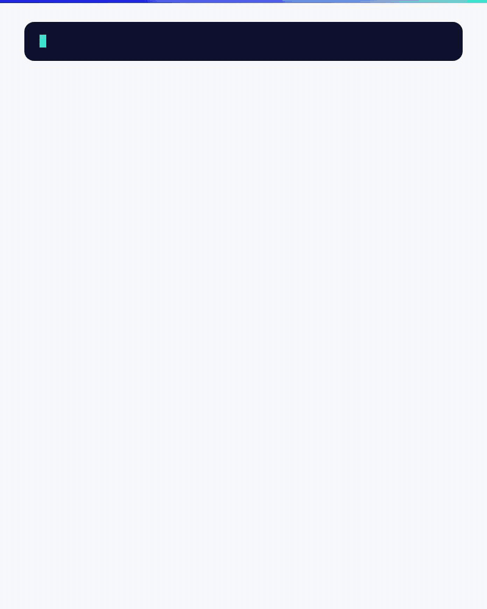

# Conferbot iOS SDK

[](https://swift.org/package-manager/)
[-000000.svg)](https://developer.apple.com/ios/)
[](https://swift.org)
[](LICENSE)
[](https://cocoapods.org/pods/Conferbot)

Add your [Conferbot](https://conferbot.com) chatbot to a native iOS app. The chat looks and behaves like the Conferbot web widget: your dashboard settings, the bot's flows, the AI agent, handover to your team, the help centre and "Your requests". It works with SwiftUI and with UIKit, or you can build your own UI on the SDK's published state.

## Quickstart video

<p align="center">
  <a href="https://github.com/Conferbot/conferbot-ios/releases/download/2.0.0/sdk-ios.mp4">
    
  </a>
</p>

<p align="center"><a href="https://github.com/Conferbot/conferbot-ios/releases/download/2.0.0/sdk-ios.mp4">Watch the full walkthrough</a> (MP4, 1080p, about 1.5 minutes): install, the bot ID, then the example app on an iPhone simulator with the launcher, the bot's flow, the AI agent answering from the knowledge base and the handover to a person.</p>

<p align="center">
  
  
  
  
</p>

**Contents:** [Requirements](#requirements) · [Install](#install) · [Get your bot ID](#get-your-bot-id) · [Add the chat](#add-the-chat) · [Sign users in](#sign-users-in) · [Push notifications](#push-notifications) · [Customising](#customising) · [Help centre and Your requests](#help-centre-and-your-requests) · [API reference](#api-reference) · [Troubleshooting](#troubleshooting) · [Contributing and testing](#contributing-and-testing)

## Requirements

| | Minimum | Notes |
|---|---|---|
| iOS, Swift Package Manager | 13.0 | `Package.swift`: `.iOS(.v13)` |
| iOS, CocoaPods | 14.0 | `Conferbot.podspec`: `ios.deployment_target = '14.0'` |
| The SwiftUI chat, launcher, home screen, help centre | 15.0 | the SwiftUI views are `@available(iOS 15.0, *)`. On iOS 13 / 14 the UIKit `ChatViewController` shows a simpler UIKit-drawn chat |
| Swift | 5.7 | `swift-tools-version: 5.7`; the podspec lists Swift 5.7 to 5.9 |
| Xcode | 14 or later | built and tested with Xcode 26 |
| Dependencies | | [socket.io-client-swift](https://github.com/socketio/socket.io-client-swift) 16.x, resolved for you. No push or Firebase library |

## Install

### Swift Package Manager

Swift Package Manager is the recommended way to install. CocoaPods has 2.0.0, but the CocoaPods trunk becomes read-only on 2 December 2026, so later versions will be published for Swift Package Manager only.

In Xcode: **File > Add Package Dependencies...**, enter

```
https://github.com/Conferbot/conferbot-ios
```

and add the **Conferbot** library to your app target.

In a `Package.swift`:

```swift
dependencies: [
    .package(url: "https://github.com/Conferbot/conferbot-ios", from: "2.0.0")
],
targets: [
    .target(name: "YourApp", dependencies: [
        .product(name: "Conferbot", package: "conferbot-ios")
    ])
]
```

> This guide describes version 2.0.0 (see [CHANGELOG.md](CHANGELOG.md)). The 1.0.0 tag does not compile; use 2.0.0 or later.

### CocoaPods

```ruby
platform :ios, '14.0'
use_frameworks!

target 'YourApp' do
  pod 'Conferbot', '~> 2.0'
end
```

Then `pod install`. If your specs repo is out of date, run `pod repo update`, or point at the tag instead: `pod 'Conferbot', :git => 'https://github.com/Conferbot/conferbot-ios.git', :tag => '2.0.0'`. The pod brings `Socket.IO-Client-Swift ~> 16.0` and ships the widget's words in its `Conferbot.bundle`.

The module is `Conferbot`; the class is `ConferBot` (capital B): `import Conferbot`, then `ConferBot.shared`.

## Get your bot ID

1. Sign in to the [Conferbot dashboard](https://app.conferbot.com) and open your bot.
2. Go to the **Share** tab. Under **Mobile apps**, pick **iOS**: the snippet there has your bot ID filled in. (The bot ID is the 24-character id of the bot; in the inbox, a bot's menu also has **Copy chatbot ID**.)
3. **Publish** the bot in the flow builder. Draft flows are not served to the SDK.

The `apiKey` argument is a placeholder for now: any non-empty value works (the dashboard's snippet uses `conf_test_key`). The bot ID is what identifies your bot.

Just trying it out? The public demo bot `691c970890527a0468f9b2c9` works without an account.

## Add the chat

### 1. Initialize once, at launch

SwiftUI:

```swift
import SwiftUI
import Conferbot

@main
struct MyApp: App {
    init() {
        ConferBot.shared.initialize(apiKey: "conf_test_key", botId: "YOUR_BOT_ID")
    }

    var body: some Scene {
        WindowGroup { ContentView() }
    }
}
```

UIKit:

```swift
import UIKit
import Conferbot

@main
class AppDelegate: UIResponder, UIApplicationDelegate {
    func application(_ application: UIApplication,
                     didFinishLaunchingWithOptions launchOptions: [UIApplication.LaunchOptionsKey: Any]?) -> Bool {
        ConferBot.shared.initialize(apiKey: "conf_test_key", botId: "YOUR_BOT_ID")
        return true
    }
}
```

`initialize` connects, loads the bot's dashboard settings and restores the visitor's last conversation when it is still valid. It traps on an empty API key or bot ID.

### 2a. SwiftUI

The floating launcher, as on the web: a button in the corner, the greeting card, the unread badge, and the chat in a sheet. Its shape, colour, icon, position and greeting come from your dashboard.

```swift
struct ContentView: View {
    var body: some View {
        NavigationView {
            MyAppContent()
        }
        .conferBotWidget()
    }
}
```

Or open the chat yourself:

```swift
struct SupportButton: View {
    @State private var showChat = false

    var body: some View {
        Button("Chat with us") { showChat = true }
            .sheet(isPresented: $showChat) {
                ChatView()
            }
    }
}
```

`ChatView` starts the conversation on first appearance. Its Help tab follows the owner's help centre setting; `ChatView(enableKnowledgeBase: false)` hides it.

### 2b. UIKit

```swift
import UIKit
import Conferbot

class SupportViewController: UIViewController {
    @IBAction func openChat(_ sender: UIButton) {
        ConferBot.shared.present(from: self)   // full screen, in its own navigation controller
    }

    func pushChat() {
        navigationController?.pushViewController(ChatViewController(), animated: true)
    }
}
```

On iOS 15+ `ChatViewController` hosts the same chat as SwiftUI, so a UIKit app gets every feature. The chat draws the bot's own header with ✕, so your navigation bar is hidden while it is on screen and put back when it goes. On iOS 13 / 14 it shows a UIKit-drawn chat in your navigation bar (plain bubbles and the composer; no step cards, home screen, help centre or requests).

There is no UIKit version of the floating launcher; open the chat from your own button, or host `.conferBotWidget()` in a `UIHostingController`.

### 2c. Your own UI (headless)

`ConferBot.shared` is an `ObservableObject`:

```swift
struct MyChat: View {
    @ObservedObject private var bot = ConferBot.shared

    var body: some View {
        List(bot.messages, id: \.id) { message in
            Text(message.id)   // draw each RecordItem your way
        }
        .task { try? await bot.startSession() }
    }
}

// Elsewhere
try await ConferBot.shared.sendMessage("Hello from my custom UI")
ConferBot.shared.initiateHandover(message: "I need help with billing")
```

A waiting flow step is `ConferBot.shared.currentUIState`; answer it with `ConferBot.shared.answerStep(FlowStepAnswer.value(4), forNodeId: nodeId)` (see `FlowStepAnswer` for each step's answer) and read its type and data with `waitingStep(nodeId)`. `ConferBotDelegate` gives the same events as callbacks.

### What the chat does

You do not need code for any of this; it follows the bot and the dashboard.

- **Flows** run as on the web: every step type the flow builder offers, with views for consent, OTP, address, signature, matrix, ranking, slider, date and time, calendar, payment and cards. GPT, AI and knowledge-base steps run on Conferbot's server; the app holds no AI key.
- **Handover to your team:** "Connecting you with the team…", the wait card with the estimate and the step's max wait, **Cancel** to leave the queue, help articles and games while the visitor waits, the agent's replies live, the post-chat rating and **Start a new chat** when it ends.
- **AI agent:** formatted answers, cited help articles, **Helpful?** with reasons, "Talk to a person" when allowed, the "took too long" notice after 45 seconds.
- **Home screen** (when the owner turns it on): greeting, "Ask anything", "Talk to us" with the team's reply time, recent help articles.
- **Chat menu:** Email me this chat, Sound on / off, Your requests.
- **Offline:** messages are queued while the phone is offline and sent when it is back (`enableOfflineMode`, on by default). Conversations persist across launches (`configureSessionStorage(expiryMinutes:)`, `clearStoredSession()`).

## Sign users in

When your app knows who the user is, tell the SDK before the chat opens. The dashboard then shows their name, email and your own fields, and "Your requests" lists their conversations.

```swift
ConferBot.shared.identify(user: ConferBotUser(
    id: "user-123",
    name: "Jane Doe",
    email: "jane@example.com",
    phone: "+1234567890",
    metadata: ["plan": AnyCodable("premium"), "company": AnyCodable("Acme")],
    hash: hashFromYourServer   // see below
))
```

Only `id` is required. Without `identify`, the SDK uses a persistent anonymous visitor id. `name` and `metadata` also fill the owner's "greet by name" placeholders such as `Hi {{first_name|there}}`.

### Identity verification (the `hash`)

Without verification, anyone could put any id or email in the app and be filed as that person. To stop that, turn on **Identity verification** in your workspace settings (**Security**) and send a `hash` with the user: the HMAC-SHA256, in hex, of the user's `id` (or their email when there is no id), keyed with your workspace's identity secret.

Make the hash **on your server** and send it to the app with the signed-in user. Never put the secret in the app.

```js
// Node.js, on your server
const crypto = require("crypto");

function conferbotUserHash(user) {
  const signed = String(user.id || user.email).trim();
  return crypto
    .createHmac("sha256", process.env.CONFERBOT_IDENTITY_SECRET)
    .update(signed)
    .digest("hex");
}

// e.g. in your login or /me response:
// res.json({ ...user, conferbotHash: conferbotUserHash(user) })
```

Conferbot checks the hash on every message and never stores it. A matching hash files the chat as verified. When the workspace **requires** verification, a missing or wrong hash drops the claimed name, email and id, so the chat is an anonymous visitor's; otherwise it is kept as unverified.

### Sign out

```swift
ConferBot.shared.identify(user: nil)
```

On a shared device the next person sees nothing of the last one's: their "Your requests" list goes at once, an answer still on its way for them is ignored, greet-by-name texts fall back, and the device's push token is unregistered from their conversation. Signing a different user in works the same way. `ConferBot.shared.clearStoredSession()` also forgets the conversation on the device.

## Push notifications

When an agent or the AI replies while the visitor is not in the chat, Conferbot can send a push (APNs). The SDK depends on no push library; nothing happens until your app hands it a token.

1. Turn on the **Push Notifications** capability for your app target.
2. Register for remote notifications and pass the token to the SDK. It is registered with the current conversation and again for each new one.
3. Forward notifications to the SDK: a tap opens its conversation; one that arrives in the foreground is counted as unread.

```swift
import UIKit
import UserNotifications
import Conferbot

final class AppDelegate: NSObject, UIApplicationDelegate, UNUserNotificationCenterDelegate {
    func application(_ application: UIApplication,
                     didFinishLaunchingWithOptions launchOptions: [UIApplication.LaunchOptionsKey: Any]? = nil) -> Bool {
        ConferBot.shared.initialize(apiKey: "conf_test_key", botId: "YOUR_BOT_ID")
        UNUserNotificationCenter.current().delegate = self
        UNUserNotificationCenter.current().requestAuthorization(options: [.alert, .sound, .badge]) { granted, _ in
            if granted { DispatchQueue.main.async { application.registerForRemoteNotifications() } }
        }
        return true
    }

    func application(_ application: UIApplication,
                     didRegisterForRemoteNotificationsWithDeviceToken deviceToken: Data) {
        ConferBot.shared.setPushToken(deviceToken)
        // With Firebase Messaging instead: ConferBot.shared.setPushToken(fcmToken, type: .fcm)
    }

    // Tapped, also from a cold start (kept until initialize, then opened).
    func userNotificationCenter(_ center: UNUserNotificationCenter,
                                didReceive response: UNNotificationResponse,
                                withCompletionHandler completionHandler: @escaping () -> Void) {
        ConferBot.shared.handlePushNotification(response.notification.request.content.userInfo)
        completionHandler()
    }

    // Arrived in the foreground: counted unread instead of taking the screen.
    func userNotificationCenter(_ center: UNUserNotificationCenter,
                                willPresent notification: UNNotification,
                                withCompletionHandler completionHandler: @escaping (UNNotificationPresentationOptions) -> Void) {
        let ours = ConferBot.shared.handlePushNotification(notification.request.content.userInfo, open: false)
        completionHandler(ours ? [] : [.banner, .sound])
    }
}
```

In a SwiftUI app, attach it with `@UIApplicationDelegateAdaptor(AppDelegate.self) private var appDelegate`.

**Opening the chat from a tap.** With `.conferBotWidget()` the chat opens by itself. Without the launcher, present your chat when asked:

```swift
ConferBot.shared.onPushOpen = { _ in
    ConferBot.shared.present(from: rootViewController)   // or show your SwiftUI ChatView
}
```

**Good to know**

- `handlePushNotification` returns `true` only for a Conferbot push of this bot, so your other notifications are untouched. `isConferbotPush(userInfo)` / `parseConferbotPush(userInfo)` read one without side effects.
- `setPushToken(nil)` or `unregisterPush()` stops this device's pushes. `registerPushToken(_:)` from 1.0.0 still works but is deprecated.
- The SDK draws no notifications; the system does, one thread per conversation.
- **Server side:** sending is off until Conferbot's embed-server runs with `MOBILE_PUSH_ENABLED=true` and APNs credentials (embed-server `docs/mobile-push.md`). The credentials are platform-wide for now, so pushes reach only apps with Conferbot's own bundle id. Per-workspace credentials for your own bundle id are not built yet (embed-server #197): until then your app's tokens register, but APNs refuses its pushes (`DeviceTokenNotForTopic`).

## Customising

### Dashboard first, code as a fallback

Almost everything is set in the dashboard (**Customize**) and applied with no code: theme (27 themes, light / dark / auto), colours, chat background, bot name and avatar, bubble and option corners, the launcher's shape, icon, motion and greeting card, the mascot, the home screen, sounds, font, language and the post-chat redirect. Once the bot's settings arrive they win.

Code is for defaults until then, and for what only the app knows:

```swift
ConferBot.shared.initialize(
    apiKey: "conf_test_key",
    botId: "YOUR_BOT_ID",
    config: ConferBotConfig(
        enableNotifications: true,
        enableOfflineMode: true,
        widgetLanguage: nil          // see Languages
    ),
    customization: ConferBotCustomization(
        primaryColor: .systemIndigo,
        bubbleCornerRadius: 16,
        headerTitle: "Support",
        botBubbleColor: .systemGray6,
        userBubbleColor: .systemIndigo
    )
)
```

The launcher is styled from the dashboard only (`ConferBotFABConfig` has no options yet).

### Languages

The SDK's own words (buttons, hints, errors, handover lines, the help centre, dates and "5 min ago") are in English, Dutch, French, German or Spanish, with the web widget's wording. The language is, in order:

1. `ConferBotConfig(widgetLanguage:)` when the app sets it: `"en"`, `"nl"`, `"fr"`, `"de"`, `"es"` or `"auto"`;
2. the language the owner picked in the dashboard;
3. for "auto" (and every bot that never chose), the first of the phone's preferred languages the widget speaks;
4. English.

What the owner wrote (greetings, questions, buttons, articles) is shown as written. `ConferBot.shared.widgetLanguage` says which language is in force; `I18n.t("chat.composer.send")` gives one of the SDK's words in it.

### Fonts

The owner's font (any of the dashboard's Google fonts) is fetched at run time, registered with Core Text for your app's process and kept in Caches. It draws the bubbles, the agent's replies, the composer, the header and the home screen, with Dynamic Type kept. A system font the owner picked is used by name, so a font your app bundles under that name is picked up. Until it loads, or when it cannot, the system font stays. `ConferBotCustomization(fontFamily:)` is the local fallback.

### Sounds

The owner's message sound and sound pack (open, message, send, close) play under the ambient audio session when your app has not set one, so the silent switch mutes them. The chat menu has **Sound on / off**; the choice is kept on the device. From code: `ConferBot.shared.sounds.soundOn` (published) and `ConferBot.shared.sounds.toggle()`.

### Redirect after the chat

When the owner sets a post-chat redirect URL, the chat shows "Taking you to example.com in 10s" with **Cancel** once the conversation ends (after the rating, if there is one), then opens the URL in the system browser. Only `http(s)` URLs are followed, and only once per conversation. To open it your own way, or to turn it off:

```swift
ConferBotConfig(
    onPostChatRedirect: { url in
        router.showWeb(url)   // your own screen
        return true           // handled: no countdown
    }
    // or: disablePostChatRedirect: true
)
```

### Hooks

The web widget's handover signals (`cb:waiting-for-human`, `cb:human-joined`, `cb:wait-over`):

```swift
let stop = ConferBot.shared.onWidgetSignal(.waitOver) { detail in
    print(detail.reason ?? "")   // unavailable, cancelled or ended
}
stop()   // stop listening
```

Events as callbacks: set `ConferBot.shared.delegate` to a `ConferBotDelegate` (messages, agent joined / left, session started / ended, unread count, connection, and optional flow, goal, queue and network events).

Analytics: `ConferBot.shared.trackGoal(goalId: "signup", goalName: "Sign Up", value: 49.0)`. Raw socket events: `ConferBot.shared.emitSocketEvent(_:data:)`. Logging: `ConferBotLogger.isEnabled = true` and `ConferBotLogger.logHandler`.

Endpoints: the SDK talks to `https://wdt.conferbot.com`. To go through your own proxy, pass `ConferBotConfig(apiBaseURL: "https://your-proxy.example.com/api/v1/mobile", socketURL: "https://your-proxy.example.com")`, or call `ConferBotEndpoints.configure(apiBaseURL:socketURL:)` (HTTPS only) before `initialize`.

## Help centre and Your requests

### Help centre

The help centre follows the bot's settings: it shows while **Help articles** is on in the dashboard and at least one article is published. `ChatView` then has a Help tab (or, with a home screen, its own view). AI answers that cite an article open it in the app.

From your own screens:

```swift
if ConferBot.shared.isHelpCentreOn {
    _ = ConferBot.shared.openHelpArticle(id: "ARTICLE_ID")   // in the chat's help centre
}

// The help centre on its own (SwiftUI, iOS 15+)
KnowledgeBaseView()
KnowledgeBaseView(articleId: "ARTICLE_ID")
```

Headless: `fetchKnowledgeBaseCategories()`, `fetchKnowledgeBaseArticles()`, `searchKnowledgeBaseArticles(query:)`, `getKnowledgeBaseArticle(id:)` (all `async throws`) and `rateKnowledgeBaseArticle(articleId:helpful:)`.

### Your requests

Visitors follow their conversations with your team and answer them, as on the web widget's home screen: the chat menu has **Your requests** once they have one (**New reply** when a team reply is unread). Only the visitor's own conversations are listed: chats this device started, or every verified conversation of a signed-in user whose `hash` is valid.

Your own entry point with a badge:

```swift
struct RequestsButton: View {
    @ObservedObject private var requests = ConferBot.shared.requests

    var body: some View {
        Button("Your requests (\(requests.unread))") { requests.open() }
    }
}

// The screens open over a view that has the portal:
MyScreen().overlay(RequestsPortalView())

// UIKit (iOS 15+)
present(RequestsViewController(), animated: true)
```

`requests.open(requestId:)` opens one request; `await requests.refresh(force: true)` reads the list again.

## API reference

All members are on `ConferBot.shared` unless noted. The SwiftUI views need iOS 15.

### Setup and chat

| Member | Description |
|---|---|
| `initialize(apiKey:botId:config:customization:)` | Set up once, at launch |
| `identify(user: ConferBotUser?)` | Sign a user in; `nil` signs out |
| `startSession(forceNew: Bool = false) async throws` | Start (or reuse the restored) conversation; `ChatView` does this for you |
| `sendMessage(_ text: String, metadata: [String: AnyCodable]? = nil) async throws` | Send as the visitor (queued while offline) |
| `sendTypingIndicator(isTyping:)` | Visitor typing, for the agent |
| `answerStep(_ response: Any, forNodeId:)` / `waitingStep(_ nodeId:)` | Answer / read the waiting flow step (`FlowStepAnswer`) |
| `initiateHandover(message: String? = nil)` | Ask for a person |
| `leaveQueue(_ done: (Bool) -> Void)` | Leave the queue; `false` when a person already has the chat |
| `endSession(clearStorage: Bool = true)` / `startNewChat()` | End the conversation / start a fresh one after it closed |
| `closedState` | `.blocked` or `.ended` once the chat closed, else `nil` |
| `sendAnswerFeedback(agentMessageId:feedback: AnswerFeedback)` | A vote on an AI answer (also `(agentMessageId:helpful:reason:)`) |
| `openEmailTranscript()` / `emailTranscript(_:done:)` | The "Email me this chat" card / send it |
| `home.showHome()` / `home.showChat(_:)` / `home.showHelp(categoryId:)` | Switch the chat's view |
| `present(from:animated:)` | Present the UIKit chat full screen |
| `hasValidStoredSession()` / `clearStoredSession()` / `configureSessionStorage(expiryMinutes:)` | The stored conversation |
| `onWidgetSignal(_:_:) -> () -> Void` | Handover signals; returns the unsubscribe |
| `delegate: ConferBotDelegate?` | Event callbacks |
| `disconnect()` | Disconnect and release the clients |

### Push

| Member | Description |
|---|---|
| `setPushToken(_ deviceToken: Data)` | The APNs device token |
| `setPushToken(_ token: String?, type: PushTokenType? = nil)` | A token as text (`.apns` or `.fcm`); `nil` unregisters |
| `unregisterPush()` | Stop this device's pushes |
| `handlePushNotification(_ userInfo:, open: Bool = true) -> Bool` | Handle a Conferbot push; `false` for anything else |
| `onPushOpen: ((ConferbotPush) -> Void)?` | Present your chat for a tapped push (without the launcher) |
| `parseConferbotPush(_:)` / `isConferbotPush(_:)` | Free functions: read a notification's payload |
| `registerPushToken(_:)` | Deprecated: `setPushToken(_:type:)` |

### Help centre and requests

| Member | Description |
|---|---|
| `isHelpCentreOn` | Help articles on, with published articles |
| `openHelpArticle(id:) -> Bool` | Open an article in the chat's help centre |
| `fetchKnowledgeBaseCategories()` / `fetchKnowledgeBaseArticles()` / `searchKnowledgeBaseArticles(query:)` / `getKnowledgeBaseArticle(id:)` | `async throws` reads |
| `rateKnowledgeBaseArticle(articleId:helpful:)` | Rate an article |
| `requests.requests` / `requests.unread` | The visitor's requests (`nil` until read) / unread team replies |
| `requests.open(requestId: String? = nil)` / `requests.refresh(force:)` | Open the list or one request / read it again |

### Published state

| Property | Type |
|---|---|
| `isConnected`, `isOnline`, `isAgentTyping`, `isLiveChatMode` | `Bool` |
| `currentSession` | `ChatSession?` |
| `messages` | `[any RecordItem]` (the conversation) |
| `currentAgent` | `Agent?` |
| `unreadCount`, `queuedMessageCount` | `Int` |
| `currentUIState` | `NodeUIState?` (the waiting step) |
| `serverCustomizations` / `customizations` | the dashboard's settings / as resolved for drawing |
| `widgetLanguage` | `WidgetLanguage` in force |

### Configuration

| `ConferBotConfig` | Default | Description |
|---|---|---|
| `enableNotifications` | `true` | Notification handling |
| `enableOfflineMode` | `true` | Queue messages while offline |
| `apiBaseURL` / `socketURL` | `https://wdt.conferbot.com/api/v1/mobile` / `https://wdt.conferbot.com` | The server |
| `widgetLanguage` | `nil` | `"en"`, `"nl"`, `"fr"`, `"de"`, `"es"` or `"auto"`; wins over the owner's |
| `onPostChatRedirect` | `nil` | `(String) -> Bool`; `true` when the app handled the URL |
| `disablePostChatRedirect` | `false` | Never follow the post-chat redirect |

| `ConferBotUser` | Description |
|---|---|
| `id` | Your user id (required) |
| `name`, `email`, `phone` | Shown in the dashboard |
| `metadata: [String: AnyCodable]?` | Your own fields; also `{{first_name}}`, `{{company}}` placeholders |
| `hash` | Identity verification HMAC, made on your server |

`ConferBotCustomization`: `primaryColor`, `fontFamily`, `bubbleCornerRadius`, `headerTitle`, `showAvatar`, `avatarURL`, `botBubbleColor`, `userBubbleColor`, `hideBrand` (the dashboard's values win).

### UI

| Type | Description |
|---|---|
| `View.conferBotWidget(config:)` / `ConferBotWidgetOverlay { }` | The floating launcher with its chat |
| `ChatView(enableKnowledgeBase: Bool? = nil)` | The full chat; `false` hides the Help tab |
| `ChatViewWithKBSheet()` | The chat with the help centre in a sheet |
| `KnowledgeBaseView(articleId:categoryId:onBack:)` | The help centre on its own |
| `HomeScreenView` | The home screen |
| `RequestsPortalView()` / `RequestsViewController()` | "Your requests" over your SwiftUI view / UIKit |
| `ChatViewController(enableKnowledgeBase: Bool? = nil)` | UIKit: the SwiftUI chat on iOS 15+, the UIKit-drawn chat on iOS 13 / 14 |

More: [docs/USAGE.md](docs/USAGE.md), [docs/API.md](docs/API.md), [docs/ARCHITECTURE.md](docs/ARCHITECTURE.md), [docs/EXAMPLES.md](docs/EXAMPLES.md).

## Troubleshooting

**The chat stays empty.**
1. Publish the bot; drafts are not served.
2. Check the bot ID (24 characters, from the Share tab).
3. The device needs HTTPS and WebSocket access to `wdt.conferbot.com`; some corporate networks and VPNs block WebSockets.
4. Try the demo bot `691c970890527a0468f9b2c9`. If it loads, the problem is your bot's id or publish state.
5. Turn on `ConferBotLogger.isEnabled` and watch the Xcode console.

**`'ChatView' is only available in iOS 15.0 or newer`.** The SwiftUI views need iOS 15. Wrap them in `if #available(iOS 15.0, *)`, or use `ChatViewController` / `present(from:)`, which works from iOS 13.

**My navigation bar disappears in the chat / my bar styling no longer applies.** On iOS 15+ the UIKit chat draws its own header and hides the bar while it is on screen; it puts it back when the chat goes. Style the chat in the dashboard. See [CHANGELOG.md](CHANGELOG.md).

**The package does not build at 1.0.0.** That tag does not compile; use 2.0.0 or later (see [Install](#install)).

**`pod install` cannot find `Conferbot`.** Run `pod repo update`, or use the `:git` and `:tag` line above.

**No push notifications.** Check the Push Notifications capability, that `setPushToken` is called, and that the user allowed notifications. Sending is off on the server until push is enabled, and for now reaches only apps with Conferbot's bundle id (see [Push notifications](#push-notifications)).

**The identity hash is rejected.** Hash exactly the `id` you pass (or the email when there is no id), trimmed, with the workspace's current secret, as hex.

**Socket.IO build errors.** Clear DerivedData; with CocoaPods, `pod deintegrate && pod install`.

## Contributing and testing

- Tests (the package is iOS only, so `swift test` does not work):
  ```bash
  xcodebuild test -scheme Conferbot -destination 'platform=iOS Simulator,name=iPhone 16 Pro'
  ```
- The example app: [Example/README.md](Example/README.md), against Conferbot's cloud or a local server.
- [docs/PARITY.md](docs/PARITY.md) tracks every web-widget feature in this SDK, with its issue, files and tests, and how to test on the simulator.
- Changes are listed in [CHANGELOG.md](CHANGELOG.md).

Bug reports and feature requests: [GitHub Issues](https://github.com/Conferbot/conferbot-ios/issues). Please open an issue before a large pull request.

## License

Apache 2.0, see [LICENSE](LICENSE).
